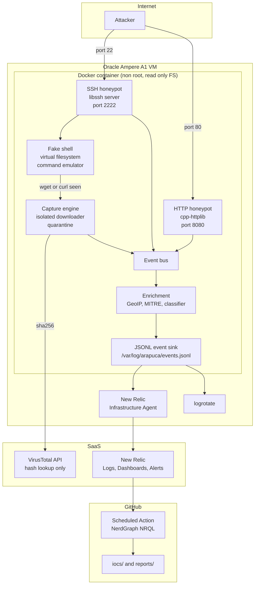

# Arapuca, Implementation Plan

> Status: **implemented**. This document is kept as written, as the plan the
> project was approved against, with a record at the end of what the build
> actually taught us. A plan that was quietly edited to match the outcome is
> worth nothing to the next person.

Arapuca is a medium interaction SSH and HTTP honeypot written in C++20. It runs on a public
VPS (Oracle Cloud Ampere A1, Always Free tier), records every interaction as structured JSON
events, enriches them with GeoIP and MITRE ATT&CK mappings, captures malware payloads into a
password protected quarantine, and ships everything to New Relic where dashboards and alerts
are provisioned as code.

---

## 1. Goals and non goals

### Goals
1. Collect real attack telemetry from the public internet with zero risk to the host.
2. Produce a portfolio grade repository: clean C++, tests, CI, IaC, documentation.
3. Everything observable: one JSON event per line, one documented schema, dashboards as code.
4. Reproducible deployment: `terraform apply` then `ansible-playbook`, nothing manual.

### Non goals (explicit, to keep scope honest)
1. Not a high interaction honeypot. No container escape sandbox, no real shell, ever.
2. No malware detonation or dynamic analysis. Only hash lookup on VirusTotal.
3. No active response (no scanning back, no blocklist pushing to third parties).
4. No paid cloud resources. If a resource is not Always Free, it is not in the Terraform.

---

## 2. Threat model and safety invariants

These are hard invariants. Every phase has tests that assert them.

| # | Invariant | Enforcement |
|---|-----------|-------------|
| S1 | Attacker input is never executed, interpreted or passed to a shell | No `system()`, no `exec*()`, no `popen()` anywhere in the codebase. Enforced by a CI grep check and by clang-tidy. |
| S2 | Every attacker controlled buffer has a hard size limit | Limits centralized in `core/limits.hpp`, applied at read time, before allocation. |
| S3 | Downloaded samples are never executable | Written with mode `0400`, inside a directory mounted `noexec` when possible, then zipped and the plain file removed. |
| S4 | Samples are never uploaded anywhere | The VirusTotal client only has a `lookup_hash()` method. There is no upload code path. |
| S5 | The honeypot process is unprivileged | Container user `arapuca` (uid 10001), listens on high ports, host maps 22 and 80 inbound. |
| S6 | The real SSH daemon is moved to another port before port 22 is exposed | Ansible play ordering, with a verification task that fails the play if the new port is not reachable. |
| S7 | Secrets never touch the repository | Environment variables only, `.env.example` with placeholders, `.gitignore` covering `.env`, `*.tfvars`, `*.mmdb`, `quarantine/`, `inventory/*`. |
| S8 | Disk cannot be filled by an attacker | Quarantine total size cap with oldest first eviction, per file size cap, logrotate on the event log. |
| S9 | The honeypot cannot be used to reach internal or cloud metadata addresses | The download path validates the **resolved IP**, not the URL text: private ranges, loopback, link local `169.254.0.0/16` (cloud metadata) and their IPv6 equivalents are rejected, on every redirect hop. |
| S10 | The fake SSH server offers no real channel to anything | Port forwarding (direct and reverse), X11 forwarding, agent forwarding, tunneling and every subsystem (SFTP, SCP, exec of a subsystem) are refused at the libssh callback level. |

### Legal and ethical note
The honeypot only records what is sent to it voluntarily by whoever connects. The README
carries an explicit disclaimer: data is collected for defensive research, IP addresses are
published only as indicators of compromise, and the operator is responsible for complying
with local law.

---

## 3. Architecture



### Process model
A single binary, `arapucad`, with one thread pool and three long lived services:

* `SshService`: `ssh_bind` accept loop, one detached session thread per connection, with a
  global connection cap and a per IP concurrent connection cap.
* `HttpService`: cpp-httplib server with its own thread pool.
* `CaptureWorker`: a bounded queue consumer. Downloads and VirusTotal lookups never happen on
  the session thread, so a slow download cannot stall the fake shell or be used for timing.

All services publish to a lock free bounded `EventBus`. A single writer thread serializes
events to JSONL and does an `fsync` policy of "every N events or every T milliseconds".
If the bus is full, events are dropped and a counter is incremented, so an attacker flood
degrades telemetry but never memory.

---

## 4. Repository layout

```
arapuca/
  CMakeLists.txt
  CMakePresets.json
  cmake/Dependencies.cmake       # pinned FetchContent declarations (see section 5)
  PLAN.md  README.md  README.pt-BR.md  LICENSE
  .gitignore  .env.example  .clang-tidy  .clang-format

  include/arapuca/               # public headers, mirrors src/
  src/
    main.cpp
    core/        config, limits, event, event_bus, event_sink, session, ids, clock, rate_limiter
    ssh/         ssh_service, ssh_session, auth_policy, shell, command_registry, vfs
    http/        http_service, routes, decoys, request_record
    capture/     url_extractor, downloader, quarantine, zip_writer, hashing, virustotal_client
    enrich/      geoip, mitre_mapper, session_classifier
    util/        strings, redaction, fs, logging

  config/
    arapuca.yaml                 # main config
    credentials.yaml             # accepted weak credentials
    filesystem.yaml              # virtual filesystem tree and file contents
    commands.yaml                # command responses that are pure templates
    mitre.yaml                   # pattern to ATT&CK technique rules
    http/                        # decoy file bodies (.env, .git/config, backup.sql, config.php)

  tests/
    unit/                        # one file per module
    integration/                 # scripted SSH sessions and HTTP request replays
    fixtures/

  deploy/
    docker/Dockerfile  docker/entrypoint.sh
    compose/docker-compose.yml  compose/logrotate.conf
    terraform/oci/               # VCN, subnet, security list, Ampere A1 instance
    terraform/newrelic/          # dashboards and alert policies
    ansible/                     # hardening, ssh port move, iptables, docker, NR agent, deploy

  tools/
    ioc_export.py                # NerdGraph NRQL to CSV and JSON
    weekly_report.py             # NerdGraph NRQL to Markdown
    requirements.txt

  .github/workflows/
    ci.yml                       # build matrix, tests, clang-tidy, ASan, UBSan
    docker.yml                   # multi arch image build and push to GHCR
    iocs.yml                     # daily IoC export, auto commit
    report.yml                   # weekly report, auto commit

  iocs/   reports/   docs/
```

---

## 5. Dependencies

**Decision (approved):** compiled libraries come from distro packages, header only libraries
come from CMake `FetchContent` pinned to an exact tag and commit hash. A clean build then
takes about two minutes instead of about thirty, and the Dockerfile stays small, which matters
because the ARM64 image is built under QEMU emulation on GitHub runners.

| Library | Use | Source |
|---------|-----|--------|
| libssh 0.10.6 | SSH server side protocol | apt `libssh-dev` |
| yaml-cpp | configuration | apt `libyaml-cpp-dev` |
| libmaxminddb | GeoLite2 lookups | apt `libmaxminddb-dev` |
| libcurl | isolated sample download, VirusTotal API | apt `libcurl4-openssl-dev` |
| OpenSSL 3 | SHA256, SSH host key generation | apt `libssl-dev` |
| minizip (zlib contrib) | zip with ZipCrypto password encryption | apt `libminizip-dev` |
| cpp-httplib | HTTP server, header only | FetchContent, pinned tag |
| nlohmann/json | event serialization, header only | FetchContent, pinned tag |
| spdlog + fmt | internal operator logging, header only mode | FetchContent, pinned tag |
| GoogleTest | unit and integration tests | FetchContent, pinned tag |

Every `FetchContent_Declare` carries `GIT_TAG <exact tag>` plus the full commit hash, never a
branch. `cmake/Dependencies.cmake` holds all of them in one place, and
`docs/DEPENDENCIES.md` lists the apt packages per distro.

**Single base image: Ubuntu 24.04 LTS (noble), which ships libssh 0.10.6.** That is the only
supported platform, in the Dockerfile, in CI and on the VPS. Ubuntu 22.04 and libssh 0.9.x are
explicitly out of scope: 0.9 lacks part of the server side callback API this project needs, and
supporting both would mean conditional compilation around the SSH core, which is the least
appropriate place in this codebase for version branches.

Consequences of standardizing:

* CMake does `find_package(libssh 0.10.6 REQUIRED)`, a hard floor, with no feature detection
  fallback and no `#ifdef` on libssh versions anywhere in `src/ssh/`.
* The Dockerfile has a single `FROM ubuntu:24.04` build stage and a single runtime stage, both
  `linux/amd64` and `linux/arm64`.
* CI runs on `ubuntu-24.04` runners only. The build matrix keeps the two architectures and the
  two compilers, and drops the distro dimension.
* The OCI instance is provisioned with a Canonical Ubuntu 24.04 ARM64 image.

**Version pinning and updates**: every dependency is pinned to an exact version (exact git
tag plus full commit hash for FetchContent, exact apt package version in the Dockerfile), and
every GitHub Action is pinned to a full commit SHA rather than a floating tag, which is the
usual supply chain advice for public repositories. `.github/dependabot.yml` watches three
ecosystems: `github-actions`, `docker` (base images) and `pip` (the IoC tooling), weekly,
grouped into a single pull request per ecosystem. Native C++ dependencies get a scheduled job
that checks for new upstream releases and opens an issue, since Dependabot does not understand
`FetchContent` declarations. CI has to be green before any bump is merged.

Notes on two choices worth flagging:

* **Zip encryption**: the convention for sharing samples is a zip with the password
  `infected` using legacy PKWARE ZipCrypto, because every tool reads it. The writer is
  minizip from the zlib contrib tree (`libminizip-dev` on noble), whose
  `zipOpenNewFileInZip3` takes a password directly. libzip was considered and rejected: it
  writes AES but only reads ZipCrypto, and AES zips are not openable by a large part of the
  analysis tooling. The zip is an anti accident measure (it stops antivirus deletion and
  accidental double clicks), not a security boundary.
* **GeoLite2 database**: the `.mmdb` file is not committed. Ansible downloads it with a
  MaxMind account key, and a monthly cron refreshes it. The code degrades gracefully to
  `geo: null` when the database is absent, so local development needs no account.

---

## 6. Event schema (draft, frozen at the end of Phase 1)

One JSON object per line, UTF-8, no nested arrays deeper than one level, so NRQL stays simple.

Common envelope, present in every event:

```json
{
  "schema_version": 1,
  "event_id": "01J...",
  "event_type": "ssh.command",
  "timestamp": "2026-11-02T14:31:07.482Z",
  "service": "ssh",
  "sensor": "arapuca-sa-east-1",
  "src_ip": "203.0.113.45",
  "src_port": 54122,
  "dst_port": 22,
  "session_id": "01J...",
  "geo": { "country_iso": "CN", "country": "China", "city": "Hangzhou",
           "latitude": 30.29, "longitude": 120.16, "asn": 37963, "as_org": "Alibaba" },
  "mitre": { "technique_id": "T1082", "technique": "System Information Discovery",
             "tactic": "Discovery" }
}
```

Per type additional fields:

| event_type | Added fields |
|------------|--------------|
| `ssh.auth_attempt` | `username`, `password`, `auth_method`, `accepted`, `client_version` |
| `ssh.session_start` | `client_version`, `kex_algo` |
| `ssh.channel_denied` | `request_type` (`direct-tcpip`, `tcpip-forward`, `x11-req`, `subsystem`, ...), `subsystem_name`, `target_host`, `target_port` |
| `ssh.command` | `command`, `command_argv0`, `seq`, `since_prev_ms`, `response_bytes` |
| `ssh.session_end` | `duration_ms`, `command_count`, `classification` (`bot` or `likely_human`), `classification_score` |
| `http.request` | `method`, `path`, `query`, `status`, `user_agent`, `headers` (truncated map), `body` (truncated, redacted), `body_truncated`, `decoy` |
| `http.login_attempt` | `username`, `password`, `path` |
| `capture.download` | `url`, `sha256`, `md5`, `size_bytes`, `content_type`, `outcome`, `quarantine_path` |
| `capture.vt_lookup` | `sha256`, `vt_detections`, `vt_total_engines`, `vt_first_seen`, `vt_popular_label`, `vt_status` |
| `honeypot.lifecycle` | `phase` (`start`, `stop`, `config_reload`), `version`, `dropped_events` |

Passwords are recorded in full: that is the point of the honeypot. The redaction layer only
strips control characters and caps length, and is applied to every attacker string.

`docs/EVENT_SCHEMA.md` holds the authoritative version, with an NRQL example per field.

---

## 7. Module design notes

### 7.1 SSH honeypot
* Host key generated on first run into a persistent volume, so the fingerprint is stable and
  attackers are not warned off by a changing key.
* Banner configurable, default a plausible `SSH-2.0-OpenSSH_8.9p1 Ubuntu-3ubuntu0.4`.
* `AuthPolicy` loads `credentials.yaml`. Accepts only listed pairs, optionally also a
  "accept after N failures" mode (common real world honeypot behavior, configurable, off by
  default). Every attempt is logged whether it succeeds or not.
* `Shell` is a command dispatcher over a `CommandRegistry`. Each command is a small C++
  handler reading from the `Vfs`. Covered in phase 3: `ls`, `cd`, `pwd`, `whoami`, `id`,
  `uname`, `cat`, `echo`, `ps`, `top`, `free`, `df`, `uptime`, `history`, `which`, `wget`,
  `curl`, `chmod`, `rm`, `mkdir`, `touch`, `crontab`, `netstat`, `ifconfig`, `ip`, `apt`,
  `service`, `systemctl`, `su`, `sudo`, `exit`. Unknown commands return a realistic
  `bash: <cmd>: command not found` and raise a "never seen command" event.
* `Vfs` is an in memory tree built from `filesystem.yaml`, copy on write per session so an
  attacker who creates a file sees it again later in the same session, and nothing persists
  across sessions.
* **Channel restrictions**: only a `session` channel with a `shell` or `exec` request is
  accepted, and the payload is recorded, never run. Everything else is refused and logged as
  its own high signal event: `direct-tcpip` and `tcpip-forward` (port forwarding in both
  directions), `x11-req`, `auth-agent-req` (agent forwarding), and every `subsystem` request,
  including `sftp` and `scp`. A refused request still produces an `ssh.channel_denied` event,
  because an attacker probing for a SOCKS proxy is itself valuable telemetry.
* Line editing, pagination and PTY quirks are handled minimally: echo, backspace, Ctrl+C,
  Ctrl+D. Enough to look real, not a terminal emulator.

### 7.2 HTTP honeypot
* Generic admin login page at `/`, `/admin`, `/login`, `/wp-login.php`, `/phpmyadmin`.
  Posting credentials always fails with a plausible error, and logs user and password.
* Decoy files served from `config/http/`, with fake but realistic content: database
  credentials, API keys shaped like the real thing but invalid, an AWS key with an invalid
  checksum. Each decoy hit is a high signal event.
* Catch all 404 that still logs everything.
* Hard limits: max header count and size, max body bytes stored (default 8 KiB, with
  `body_truncated` flag), max URL length.

### 7.3 Capture engine
1. `UrlExtractor` parses the attacker command line (tokenizer, not a shell) and pulls URLs
   from `wget`, `curl`, `tftp`, and `nc` style one liners.
2. `Downloader` uses libcurl with: fixed total timeout, connect timeout, max redirects,
   max download size with incremental abort, allowed schemes `http` and `https` only,
   no cookies, no auth, generic user agent.
   SSRF protection is done on the **resolved address**, never on the URL string, because a
   hostname can point anywhere. Implementation: `CURLOPT_OPENSOCKETFUNCTION` inspects the
   `sockaddr` libcurl is about to connect to and refuses the connection unless the address is
   global unicast. The check runs again on every redirect hop, which also closes the DNS
   rebinding window between the resolution and the connect. Rejected ranges:

   | Family | Blocked |
   |--------|---------|
   | IPv4 | `0.0.0.0/8`, `10/8`, `100.64/10`, `127/8`, `169.254/16` (cloud metadata), `172.16/12`, `192.0.0/24`, `192.168/16`, `198.18/15`, `224/4`, `240/4` |
   | IPv6 | `::`, `::1`, `fc00::/7`, `fe80::/10`, `ff00::/8`, and IPv4 mapped forms of all of the above |

   The same predicate is reused by the unit tests and is the single source of truth, so a new
   range is added in one place. Oracle Cloud metadata lives at `169.254.169.254`, so this is
   the control that stops the honeypot being turned against its own instance credentials.
3. `Quarantine` computes SHA256, writes `<sha256>.zip` with password `infected`, mode 0400,
   removes the plaintext, and records metadata in a sidecar JSON.
4. Retention: a total size cap (default 2 GiB) and a file count cap. On overflow, oldest
   first eviction. Deduplication by hash, a repeated sample only bumps a counter.
5. `VirusTotalClient` queues the hash, respects the free tier limits (4 requests per minute,
   500 per day) with a token bucket persisted to disk so restarts do not blow the quota.
   API key from `VT_API_KEY`. Absent key means the feature is simply disabled.

### 7.4 Enrichment
* `GeoIp`: GeoLite2-City and GeoLite2-ASN, opened read only, thread safe lookups.
* `MitreMapper`: rules in `mitre.yaml`, each rule is `{ id, technique, tactic, match: {
  event_type, regex or prefix } }`, first match wins, evaluated against the command or path.
  Seed set: T1110 Brute Force, T1105 Ingress Tool Transfer, T1082 System Information
  Discovery, T1087 Account Discovery, T1059.004 Unix Shell, T1070.003 Clear Command History,
  T1053.003 Cron, T1021.004 SSH, T1046 Network Service Discovery, T1552.001 Credentials in
  Files.
* `SessionClassifier`: bot versus likely human from inter command timing (median and standard
  deviation of `since_prev_ms`), typo presence, use of tab or arrow keys, and session length.
  A simple weighted score with a documented threshold, not machine learning.

---

## 8. Observability

* New Relic Infrastructure Agent with a `logs.yml` tailing `events.jsonl`, `log_type` set to
  `arapuca`, automatic JSON parsing on.
* Terraform provider `newrelic` provisions:
  * Dashboard "Arapuca Overview": attacks per hour, top source countries (world map), top
    usernames, top passwords, top commands, MITRE technique breakdown, session classification
    split, captured malware table with VirusTotal detections.
  * Dashboard "Arapuca Sessions": session drilldown, longest sessions, command sequences.
  * Alert policy with three conditions: login attempt spike (baseline), first sighting of a
    never seen command, any successful malware capture.
* Every NRQL query lives in the Terraform, so the dashboard is reproducible from scratch.

---

## 9. Infrastructure

### Terraform, OCI
VCN, public subnet, internet gateway, route table, security list opening 22, 80 and the real
SSH port (restricted to an operator CIDR variable), one `VM.Standard.A1.Flex` instance
(4 OCPU, 24 GB, inside Always Free), Canonical Ubuntu 24.04 ARM64 image, boot volume 50 GB.
A `precondition` block fails the plan if a shape outside the free tier is requested.

### Ansible, ordered for safety
1. Base hardening: unattended upgrades, fail2ban on the real SSH port, sysctl tuning.
2. Move real sshd to `{{ real_ssh_port }}`, reload, **verify the new port answers**, only
   then continue. If verification fails, the play aborts and port 22 is never freed.
3. iptables rules (Oracle Ubuntu images ship a restrictive `INPUT` chain, so this is required,
   not optional), persisted with `netfilter-persistent`.
4. Docker engine and compose plugin.
5. New Relic Infrastructure Agent, license key from an environment variable.
6. Deploy the compose stack, install logrotate config, install the GeoLite2 refresh cron.

### Container hardening
`user: "10001:10001"`, `read_only: true` with explicit tmpfs for `/tmp`, named volumes for
quarantine, logs and host key, `security_opt: [no-new-privileges:true]`,
`cap_drop: [ALL]`, `cpus: 1.5`, `mem_limit: 512m`, `pids_limit: 256`, restart policy
`unless-stopped`, healthcheck on an internal status endpoint bound to localhost.

---

## 10. Implementation phases

Each phase ends with: tests passing, clang-tidy clean, and one Conventional Commit.

| # | Phase | Deliverable | Commit |
|---|-------|-------------|--------|
| 0 | Bootstrap | git init, CMake, presets, pinned `cmake/Dependencies.cmake`, .gitignore, .env.example, clang-format, clang-tidy, dependabot.yml, CI skeleton building a hello binary on both arches | `chore: bootstrap build system and CI` |
| 1 | Core | Config loader, limits, Event model, EventBus, JSONL sink with rotation friendly writes, session ids, structured internal logging. Unit tests for schema stability and bounded bus behavior | `feat(core): event model, bus and JSONL sink` |
| 2 | Enrichment | GeoIp, MitreMapper, SessionClassifier, with fixtures and table driven tests | `feat(enrich): geoip, MITRE mapping and session classification` |
| 3 | SSH honeypot | libssh server, auth policy, virtual filesystem, fake shell, command registry, session recording. Integration test driving a real SSH client against a test instance | `feat(ssh): medium interaction SSH honeypot with fake shell` |
| 4 | HTTP honeypot | Admin panel, decoy files, full request logging with limits. Integration test replaying real world scanner requests | `feat(http): fake admin panel and decoy files` |
| 5 | Capture | URL extraction, isolated downloader with resolved address SSRF guards, quarantine with zip and retention caps, VirusTotal hash lookup with persisted rate limiting | `feat(capture): malware quarantine and VirusTotal hash lookup` |
| 5b | Fuzzing | libFuzzer targets for the SSH and HTTP parsers, seed corpus, CI smoke job | `test: libfuzzer targets for attacker facing parsers` |
| 6 | Packaging | Multi arch Dockerfile, compose with hardening, entrypoint, logrotate, healthcheck | `build: multi-arch container and hardened compose stack` |
| 7 | Cloud infra | Terraform OCI, Ansible roles with the safe SSH port move | `feat(infra): OCI terraform and ansible deployment` |
| 8 | New Relic | Agent log forwarding config, Terraform dashboards and alert policies | `feat(observability): new relic dashboards and alerts as code` |
| 9 | IoC feed | NerdGraph export scripts, scheduled Actions, auto commit of `iocs/` and `reports/` | `feat(iocs): scheduled IoC feed and weekly report` |
| 10 | Documentation | README.md, README.pt-BR.md, EVENT_SCHEMA.md, architecture diagram, dashboard screenshot placeholders, legal notice | `docs: english and portuguese documentation` |

Phases 1 to 5 are the core of the project. Phases 6 to 10 are deployment and presentation.

---

## 11. Testing strategy

* **Unit**: every module, with table driven cases. Target: all parsing and limit logic.
* **Integration**: a test harness starts the honeypot on ephemeral ports, then
  * drives scripted SSH sessions (a brute force bot, a Mirai style one liner, a human
    looking exploration) and asserts the produced event sequence,
  * replays captured scanner HTTP requests and asserts status codes and events.
* **Safety tests**: assert no `exec` family symbol is linked, assert oversized input is
  rejected, assert the downloader refuses private addresses and oversized bodies, assert
  quarantine files are never mode `+x`.
* **Fuzzing**: libFuzzer targets over every parser that touches attacker bytes, built with
  `-fsanitize=fuzzer,address,undefined`:
  * `fuzz_ssh_command_line`: the shell tokenizer and argument parser,
  * `fuzz_url_extractor`: URL extraction from `wget` and `curl` one liners,
  * `fuzz_http_request`: request line, header block and body handling, including the decoy
    router,
  * `fuzz_terminal_input`: the line editor and control character handling,
  * `fuzz_config`: YAML config loading, since config is trusted but malformed files should
    fail cleanly rather than crash.

  A seed corpus lives in `tests/fuzz/corpus/`, built from real scanner traffic and from the
  integration fixtures. CI runs each target for a short, fixed time budget (60 seconds) on
  every pull request, so it catches regressions without making the pipeline slow. Crashes
  found are committed to `tests/fuzz/crashes/` as regression cases for the normal unit tests.
* **CI**: all jobs on `ubuntu-24.04`. Build matrix `{x86_64, arm64} x {gcc, clang}`, plus one
  ASan and UBSan job, one clang-tidy job and the fuzzing smoke job. Multi arch via QEMU on
  GitHub runners.

---

## 12. Risks and mitigations

| Risk | Mitigation |
|------|------------|
| Being locked out of the VPS during the SSH port move | Ansible verification gate before exposing 22, plus OCI serial console access documented as the recovery path |
| libssh API differences between distro versions | Not applicable by decision: Ubuntu 24.04 with libssh 0.10.6 is the single supported base, in CI, in the container and on the VPS. A future libssh bump is a deliberate, tested change, not a runtime fallback |
| An attacker uses the honeypot as a download proxy | Downloader restricted to the URL seen in the session, hard caps, private ranges blocked, rate limited per session |
| VirusTotal quota exhaustion | Persisted token bucket, dedupe by hash, lookups are best effort and never block capture |
| GeoLite2 licensing | Database not committed, downloaded at deploy time, code works without it |
| New Relic free tier data cap (100 GB per month) | Event size kept small, body truncation, a sampling switch available if volume grows |

---

## 13. Open questions

1. ~~**Dependency management**~~ **Resolved**: distro packages for compiled libraries, pinned
   `FetchContent` for header only libraries. See section 5.
2. **Sensor identity in events**: publish the sensor name and region in the IoC feed, or keep
   the sensor anonymous? Affects the schema and the public repository.
3. **Real deployment**: will the OCI and New Relic resources actually be applied during this
   project, or is the IaC validated only with `terraform validate` and `ansible-lint`?

---

## 14. Conventions

* Code, comments, commit messages and documentation in English. A Portuguese README mirrors
  the English one.
* Conventional Commits, one commit per phase, scoped (`feat(ssh): ...`).
* No em dash anywhere in the repository text. Commas, colons and parentheses instead.
* `.gitignore` covers `.env`, `*.tfvars`, `*.tfstate*`, `*.mmdb`, `quarantine/`, `build/`,
  `inventory/hosts.yml`, and any file that could carry the real VPS address.


---

## 15. What the build changed

Kept as a record. Every item below cost real time, and the reasoning is worth
more than the plan that preceded it.

### The shape of the deployment

**Ampere A1 was not obtainable.** The plan assumed 4 OCPUs and 24 GB. The
tenancy's limit turned out to be 2 and 12, and even that failed with
`Out of host capacity`, which is a capacity problem in the region rather than
an account one. The deployment targets `VM.Standard.E2.1.Micro`, 1 OCPU and
1 GB, which is what is reliably obtainable. The container limits and the swap
file in cloud-init exist because of that.

**Four instances were destroyed before one worked**, and all four failures
were the same underlying thing: restarting an SSH unit from inside cloud-init.
`ssh.socket` is ordered after `cloud-init.service`, so a synchronous
`systemctl restart` deadlocks the boot. The instance still answers TCP,
because the kernel and network came up first, but has no sshd, no snapd and
no cloud agent, which makes it completely unmanageable. `--no-block` avoided
the hang without fixing the outcome. What works is writing configuration and
rebooting, which is what the template does now. `docs/DEPLOYMENT.md` carries
the full account, including the two out of band diagnostic channels that
found it.

### Dependencies

vcpkg was dropped in favour of distro packages plus pinned `FetchContent` for
header only libraries, which took a clean build from roughly thirty minutes to
two. The sanitizer presets moved from clang to GCC, because GCC ships its
sanitizer runtime with the compiler while clang needs a separate package that
is easy to be missing. Clang stays where it is actually required, which is the
libFuzzer targets.

`minizip-ng` became plain `minizip` from the zlib contrib tree: libzip writes
AES but only reads ZipCrypto, and an AES zip is not openable by a large part
of the analysis tooling.

### Things the plan did not anticipate

**A sensor silence alert.** The plan listed three alert conditions, all about
attacks. A honeypot that silently stopped collecting is the one failure that
costs data instead of producing it, so a fourth condition fires when nothing
has been reported for an hour.

**A corpus replay mode for the fuzz targets.** libFuzzer needs clang and its
runtime. Building each target as a plain replay binary as well means the
committed corpus and every recorded crash are exercised by an ordinary build,
so a defect found once stays found even where libFuzzer is unavailable.

**A development configuration.** `config/arapuca.dev.yaml` keeps everything
writable inside the checkout. The production file writes to `/var/log/arapuca`
and fails on a developer machine, which is correct behaviour and a bad first
experience.

### Defects the gates caught

* clang-tidy found a string literal constructed with a hand counted length
  that read one byte past its end. The test passed anyway.
* Running the container found a `std::thread` destroyed while joinable, which
  turned a readable startup error into `terminate called without an active
  exception`. Loading now happens before any thread exists.
* Running the container also found that relative paths in the configuration
  meant different things depending on the working directory, and nothing at
  all inside the image.

None of the three would have been found by reading the code.
